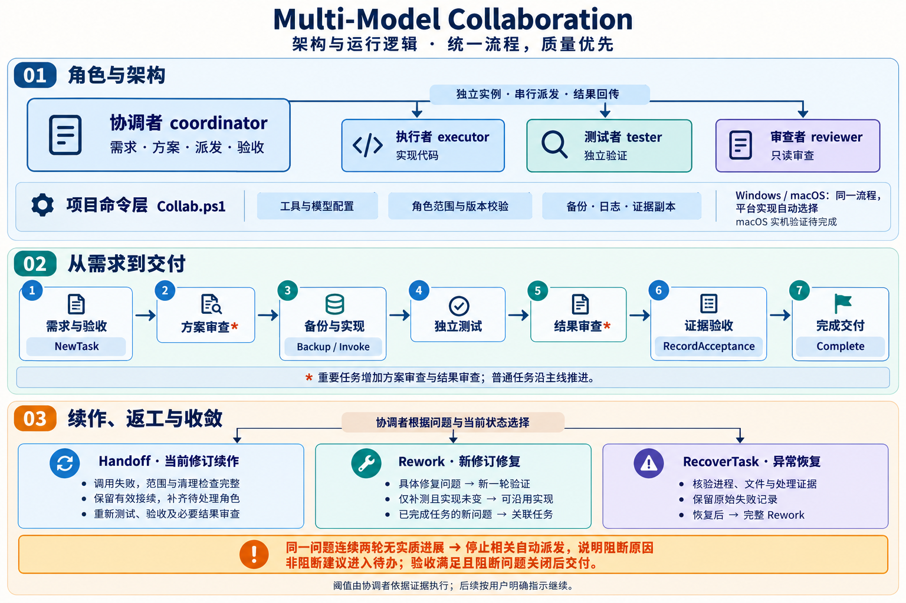

# Multi-Model Collaboration

**简体中文** | [English](README.en.md)

**面向软件开发、以明确分工和独立验证提升交付质量的多模型协作 Skill。**

Multi-Model Collaboration 让编程助手的主会话担任协调者，将实现、测试和审查交给职责明确的独立模型会话。所有参与者围绕同一组需求、文件版本和验收条件工作，协调者根据实际代码与验证证据完成交付。

这个技能包含协作指引、项目初始化器、运行脚本、工具配置模板和本地测试。接入项目后，它会记录每次派发、任务修订和验收证据，让后续工作能够接着已有成果推进。模型和执行工具由项目自行配置，同一模型也可以通过不同的独立会话承担不同角色。



[查看完整架构图](assets/diagrams/architecture-workflow.png)

## 适合什么工作

- **功能开发**：先明确预期行为，再由执行者实现、测试者独立验证。
- **缺陷修复**：围绕复现步骤和失败证据修复，检查边界与回归影响。
- **跨文件重构**：用明确的文件职责和验收条件衔接改动，重要任务增加方案与结果审查。
- **交付验证**：核对当前版本、测试输出和真实用户流程，形成有据可查的交付结论。

它尤其适合需要独立检查、涉及多轮修复或需要保留交接证据的开发工作。采用这套流程需要配置模型工具，并承担独立调用、文件核验和证据记录的开销；任务规模与风险决定审查深度。

## 四个角色怎样协作

“实例”是一次具备独立身份和上下文的模型工作会话。角色代表职责，具体使用哪个模型由项目配置决定。

| 角色 | 负责什么 | 交付什么 |
|---|---|---|
| 协调者 coordinator | 主会话理解需求、规划任务、选择工具、派发工作并验收 | 目标、文件范围、验收条件和最终结论 |
| 执行者 executor | 在指定文件范围内实现功能或修复 | 实际代码改动、实现说明和相关检查结果 |
| 测试者 tester | 独立检查实现，编写或执行测试，覆盖边界与回归 | 测试结果、复现步骤和缺陷证据 |
| 审查者 reviewer | 只读审查方案或成果，发现正确性问题、遗漏和风险 | 审查结论、具体发现和依据 |

实现文件与测试者维护的文件在任务创建时划定，已有冻结测试保留原件。协调者统一安排派发与集成，工作实例完成本次交付后回传。当前受管调用在同一项目中按顺序执行，各角色使用独立会话。

## 一项需求如何完成

整套技能使用统一的开发流程，任务等级决定其中需要哪些审查环节。

1. **明确目标**：协调者阅读项目规则与相关源码，把需求转为可检查的验收条件，并确定文件范围和任务等级。
2. **准备方案**：普通任务按方案进入实现；重要任务先经过独立方案审查。
3. **备份并实现**：保存原件，由执行者在指定范围内完成改动，记录调用身份和产物版本。
4. **独立测试**：测试者根据需求验证当前实现，提供可复现的结果与缺陷证据。
5. **审查成果**：重要任务增加独立结果审查，检查当前改动及测试依据。
6. **逐项验收并交付**：协调者核对源码、差异和原始输出，登记当前版本的验收结果；需要真实用户流程的任务也验证该流程。

例如，开发“订单筛选”时，协调者先明确筛选组合、空结果和重置行为；执行者实现界面与逻辑；独立测试者验证这些行为及相关回归。发现影响验收的缺陷后，进入有明确目标的修复与验证；验收满足后完成交付。

最终得到的是**项目改动、独立验证结果、必要的审查结论，以及能够定位到当前版本的交付说明和证据**。这些记录也为后续接续与复查提供依据。

## 如何兼顾质量、沟通与开销

质量保障来自职责分离、当前版本验证和协调者验收。普通任务包含实现与独立测试，重要任务增加方案与结果审查；检查力度随风险调整。

交接按角色准备材料：执行者关注需求与实现范围，测试者关注验收与边界，审查者关注被审对象与证据。稳定背景通过文件路径和摘要引用，返工重点传递变化与当前问题。工作实例一次收到完整的交付目标、验收依据和阻断条件，返回结论及关键证据；相关改动、失败或证据冲突触发进一步检查。这些做法用于减少重复复制、重复总结和无目标复查带来的 token 开销。

仅需补充验证或修正测试文件时，经运行时核验有效且未变化的实现可以沿用，新修订仍取得独立测试、验收和必要结果审查。模型与推理参数由项目根据能力、质量要求和资源预算配置，实际耗时与 token 消耗取决于任务和工具。

同一问题使用稳定 ID 记录尝试与验证。**连续两轮无实质进展时，协调者停止该问题相关的自动派发**，说明两轮证据、阻断原因和继续所需条件，按用户明确的继续指示恢复。这个阈值由协调者按证据执行；未满足的验收项保持未通过。非阻断建议记录裁决或待办，验收满足且阻断问题关闭后交付。

## 中断、续作与返工怎样衔接

| 遇到的情况 | 后续处理 |
|---|---|
| 普通调用失败，文件与进程清理检查完整 | 用 `Handoff` 在当前修订内续作；连续交接保留仍有效的成功接续结果，完成交接后的独立测试、验收和必要结果审查后直接 `Complete` |
| 当前任务出现具体的验收阻断问题 | 用 `Rework` 开始新修订；符合条件的补测或测试文件修复可沿用未变实现 |
| 出现范围违规、扫描中断或清理待核验 | 处理现场并用 `RecoverTask` 核验，随后通过完整 `Rework` 重新实现与验证 |
| 已完成任务出现新问题，或目标、范围、等级改变 | 创建关联任务，引用前继成果与未解决事项；同一问题的尝试历史继续保留 |

验收登记保存证据独立副本及其来源，后续报告更新时仍能回看原有内容。旧版记录直接引用源报告的任务，需要在原路径保留旧原件，将新报告输出到已授权的新路径或任务 inbox。遗留锁、扫描排除与恢复证据的操作步骤见 [异常恢复说明](references/recovery.md) 和 [交接说明](references/handoff.md)。

## 环境准备

| 环境 | 依赖与平台实现 |
|---|---|
| Windows | PowerShell 7.4+、NTFS；使用 Windows Job Object 管理受管进程 |
| macOS | PowerShell 7.4+、Python 3.11+；使用专用进程组与进程身份检查，保存 macOS 文件元数据 |
| 模型工具 | 用户准备对应 CLI 或 JSON 适配器，并在项目中登记入口和模型参数 |
| 本地测试 | PowerShell 7.4+、Python 3.11+；测试工具在本地生成确定性结果 |

用户按当前操作系统准备对应依赖，运行脚本选择相应的平台实现。平台实测进度与测试范围记录在 [验证记录](references/validation.md)。

当前 Windows 已开展隔离回归，macOS 已加入平台实现，实机验证与多进程 CLI 清理验收仍在推进。

## 安装与开始使用

将本目录复制到编程助手的技能目录，文件夹命名为 `multi-model-collaboration`。例如 Codex 的默认技能目录是 `~/.codex/skills/`。保持目录内部结构完整。

在目标项目会话中输入：

```text
使用 $multi-model-collaboration，为当前项目准备协作接入方案。
```

协调者生成文件级方案，展示接入内容、验证与回滚安排，确认后写入项目。接入细节见 [项目接入说明](references/onboarding.md)。

项目接入后可以提出具体开发目标：

```text
使用 $multi-model-collaboration，实现订单筛选功能。
先明确验收条件，安排实现与独立测试，最后汇总实际验证结果。
```

重要变更示例：

```text
使用 $multi-model-collaboration，重构权限校验流程。
先安排独立方案审查，实现后进行独立测试与结果审查。
```

## 模型和工具配置

默认工具表为空。将 [examples/tools.json](examples/tools.json) 作为起点，填写项目实际使用的工具：

- `id`：自定义工具名称。
- `executable`：当前平台的可执行文件绝对路径。
- `requestedModel`：项目请求的模型；具体传递方式与空值处理见工具接入约定。
- `allowedRoles`：该工具可以承担的角色。
- `commonArgs` / `roleArgs`：公共调用参数与角色参数。
- `preferenceOrder`：项目自行选择的工具顺序。

通用 JSON 适配器统一返回最终结果、实际会话身份及可用的模型信息。具体协议、原生 CLI 适配器和就绪检查见 [工具接入约定](references/tools.md)。

## 包内文件与阅读入口

整个目录构成一个完整 skill。安装与上传时保留内部结构，包括隐藏的 `assets/project/.agents/` 目录。

| 文件或目录 | 用途 |
|---|---|
| [README.md](README.md) / [README.en.md](README.en.md) | 面向使用者的项目介绍、环境准备与上手入口 |
| [SKILL.md](SKILL.md) / [SKILL.en.md](SKILL.en.md) | 面向 agent 的执行指导：角色、流程、交接、验收与停止条件 |
| [references/](references/) | 按需查阅的命令流程、接入、恢复和证据规则 |
| [scripts/Initialize-Project.ps1](scripts/Initialize-Project.ps1) | 为目标项目生成、应用或回滚接入方案 |
| [assets/project/](assets/project/) | 随包提供的项目规则、运行脚本、工具配置与任务模板 |
| [assets/diagrams/](assets/diagrams/) | 中英文架构与运行流程图 |
| [examples/tools.json](examples/tools.json) | 工具与模型配置示例 |
| [agents/openai.yaml](agents/openai.yaml) | 客户端显示信息 |
| [tests/](tests/) | 本地验证脚本和确定性测试工具 |

项目初始化器从 `assets/project/` 复制运行所需内容。接入后的项目包含规则文件、`.agents/collaboration/` 下的命令说明、配置与模板，以及 `scripts/collaboration/` 下的运行脚本；任务运行时再产生对应记录。

## 本地验证

在 skill 根目录运行：

```powershell
pwsh -NoProfile -File tests/Test-Package.ps1 -Python /absolute/path/to/python
```

`-Python` 填写本机 Python 路径；省略时 Windows 查找 `python`，macOS 查找 `python3`。测试在新建的独立目录验证接入、回滚、普通与重要任务、版本校验、独立性、扫描中断恢复、恢复后交接、锁并发和进程清理，并输出记录路径。平台实测与模拟测试分别记在 [验证记录](references/validation.md)。

## 进一步阅读

- [Agent 执行指导](SKILL.md)
- [接入与回滚](references/onboarding.md)
- [开发、测试与验收](references/workflow.md)
- [任务交接与上下文](references/handoff.md)
- [返工与角色上下文](references/iteration.md)
- [工具接入约定](references/tools.md)
- [异常恢复、扫描与角色边界](references/recovery.md)
- [验证记录](references/validation.md)
