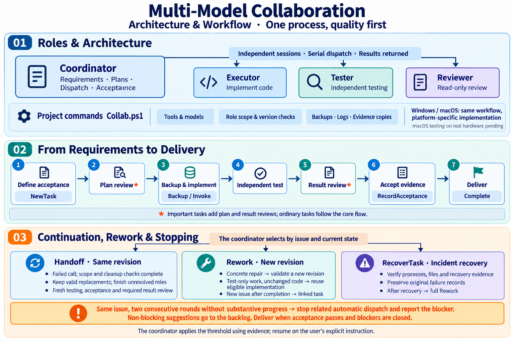

# Multi-Model Collaboration

[简体中文](SKILL.md) | **English**

Use these instructions to coordinate quality-first software development: the coordinator establishes goals and acceptance criteria, the executor implements, an independent tester verifies, and a reviewer examines plans and results according to task risk. See [README](README.en.md) for the project introduction, installation and usage examples.



[View full-size diagram](assets/diagrams/architecture-workflow.en.png)

## Entry and preparation

Use this skill for feature development, bug fixes, refactoring and delivery verification. The main conversation acts as coordinator. Establish the target project, the phase requested by the user, change scope and verifiable acceptance criteria. If the user requests analysis or a proposal first, complete that phase.

- **Project not yet configured:** read [Project onboarding](references/onboarding.md). Use `Plan` in `scripts/Initialize-Project.ps1` to generate a file-level proposal with expected effects, validation and rollback arrangements. After approval, run `Apply` and check original backups, setup records and tool readiness.
- **Configured project:** read the rules referenced by the project's `AGENTS.md`, its `.agents/collaboration/README.md` and relevant command templates in full. Run the following commands to inspect task and tool state, then follow the [project workflow](references/workflow.md).

```powershell
pwsh -NoProfile -File scripts/collaboration/Collab.ps1 Status
pwsh -NoProfile -File scripts/collaboration/Collab.ps1 Doctor
```

Run project commands from the project root and obtain exact arguments from the project command README and templates. Subsequent status queries should resolve a specific uncertainty about phase, version, locks or tool state.

Public commands require PowerShell 7.4+. Windows project and backup directories use local NTFS; macOS also requires Python 3.11+. Both platforms follow the same workflow, with scripts selecting the platform implementation. Windows has undergone isolated regression testing. macOS real-machine validation and cleanup acceptance for multi-process CLIs remain pending; use [Validation](references/validation.md) when assessing the environment.

Use the complete repository or ZIP and preserve the configuration and templates under `assets/project/.agents/`. The initializer checks 29 project asset files first. For `package_incomplete`, restore the same-version files listed in `MissingPaths`, then rerun `Plan`. Configuration validation identifies the file and missing or incorrectly typed fields; follow the [onboarding diagnostics](references/onboarding.md#接入诊断) before continuing.

Run `pwsh -NoProfile -File tests/Test-Distribution.ps1` to verify the distribution and configuration diagnostics. See [validation](references/validation.md) for full collaboration regression and platform progress. The project uses the [MIT License](LICENSE).

## Assign roles and file ownership

An instance is a model work session with an explicit task, role and identity. Independent instances can use the same model or different models selected through project configuration.

| Role | Responsibility | Deliverables |
|---|---|---|
| coordinator | The main conversation understands requirements, plans and splits tasks, dispatches work, reads source and evidence, and organizes rework and acceptance | Task scope, acceptance criteria, dispatch materials and delivery conclusions |
| executor | Implements the assigned change within its file scope | Code changes, implementation notes and relevant verification results |
| tester | Independently checks requirements and implementation, writes or runs tests, and covers boundaries and regressions | Test results, reproduction steps and defect evidence |
| reviewer | Reviews the plan or current result with read-only access, checking correctness, omissions and risks | Verdict, concrete findings and supporting evidence |

The executor owns implementation code, the tester owns test code, and the coordinator owns organization and acceptance. At task creation, `AllowedPath` lists all writable files and `TesterWritePath` selects the tests and test artifacts owned by the tester. Other writable files belong to the executor. Existing frozen tests retain their originals. Implementation, testing and review use separate instances. The coordinator arranges model calls and integration; each worker returns its assigned deliverable.

For tool setup, `ProbeTool` performs local version or capability checks. When model-assisted analysis of compatibility is useful, a task can invoke the read-only `probe` role using a ready tool and an independent instance.

Use explicit file paths with consistent casing and check role boundaries by file identity. See [Role boundaries](references/recovery.md) for platform rules.

## Execute the unified workflow

### 1. Understand the request and project

The coordinator reads the project's `AGENTS.md` and its referenced collaboration rules, then checks progress, relevant source, user requirements and available tools. Establish the goal, change scope and verifiable acceptance criteria before implementation.

When the user requests analysis or a proposal first, deliver that phase. Once implementation begins, continue within the agreed scope.

### 2. Plan the work and reviews

The coordinator chooses a task grade under project rules and records the reason. Follow the [project workflow](references/workflow.md) and use `NewTask` to record the objective, authorization, acceptance criteria, named file scope and grade. An ordinary task goes through implementation, independent testing and coordinator acceptance. An important task adds independent plan review before implementation and result review after testing.

A localized fix with clear impact may be ordinary. Changes to critical behavior, data structures or substantial architecture should be assessed as important under project rules. Review depth follows risk; responsibilities and acceptance principles apply throughout.

### 3. Dispatch and implement

The coordinator preserves originals through `Backup`, uses `Advance` as required by the current phase, and dispatches the executor through `Invoke`. Follow the project workflow for the precise order and gates. Supply exact file scope, current versions, necessary context and acceptance criteria, then collect actual changes and verification results.

Every managed invocation uses a fresh `InstanceId`. Managed calls within a project run serially, with task records linking each invocation to its artifacts.

### 4. Test independently and review the result

The tester checks the current implementation against requirements and acceptance criteria, runs relevant tests and records reproducible results. Existing frozen tests remain stable acceptance evidence.

Important-task result reviews target the current file version. When an issue affects agreed acceptance or progress, the coordinator uses `Rework` to begin a new revision of the same task. Give the responsible role the location, impact, evidence and expected outcome, then verify the corrected version. Changes to the objective, scope or grade use a linked task.

Use short issue IDs to connect locations, dispositions and verification evidence. Keep the same ID for the same issue. The coordinator records whether it is fixed, still open or disputed with evidence. Deliver once acceptance is satisfied and blocking issues are closed. Record non-blocking suggestions as dispositions or backlog items; they do not trigger rework.

### 5. Accept and deliver

The coordinator reads the actual source, changes and original output, and checks every acceptance criterion. When the task requires a real user workflow, include verification of that workflow.

Completion refers to the current artifact version. The delivery explains what changed, what was verified, where the evidence is and what still needs follow-up. Clean up task-owned processes and browsers as part of delivery.

## Prepare dispatch and collect results

Prepare material for the assigned role: requirements, relevant source and write scope for executors; acceptance criteria, implementation and boundary cases for testers; the plan or changes and supporting evidence for reviewers.

A handoff includes six kinds of information:

1. **Identity:** task, role, invocation and instance.
2. **Goal:** the issue, file scope and acceptance criteria.
3. **Version:** current file digest and the applicable plan or result digest.
4. **Material:** necessary source, project rules, existing artifacts and evidence paths.
5. **Progress:** completed work, new findings and unresolved issues.
6. **Delivery:** expected artifacts, verification results and evidence locations.

Dispatch a complete intended outcome, including acceptance criteria, role scope and blockers to report. Workers finish the relevant work and checks, then return their results. Rechecks follow relevant changes, failures or conflicting evidence. The coordinator uses existing results to choose the next action and queries status to resolve specific uncertainties.

Reference accessible authoritative files for stable context. Rework adds the delta and material needed for the current round. Extract decisive command results first and open original records when needed for a decision. This reduces tokens spent copying, translating and summarizing the same information.

Dispatch briefs and worker responses use English; user-facing delivery uses Chinese. Keep code identifiers unchanged. For dispatch and rework, read [Handoffs and context management](references/handoff.md) and check actual invocation identity, valid versions and operations allowed in the current state.

Follow the return protocol in the project command README. Check invocation identity, actual version, changes, verification commands, exit codes, evidence locations and unresolved issues. Reviewers emit the required final `COLLAB_VERDICT` line; the coordinator reads original results before registering them through `RecordReview`, `RecordAcceptance` and `Complete`. Adjudicate findings in `PASS WITH NITS`; treat issues affecting acceptance as blockers.

`PrepareContext` assembles the current brief, role focus, acceptance criteria, delta and evidence locations into a context package. Source and stable background remain path-and-digest references. `Invoke` uses `ContextId` to check role, revision and referenced files. Regenerate the relevant context package when its materials change.

## Rework and evidence continuity

The coordinator records repair attempts and verification results under the same issue ID. **After two consecutive rounds without substantive progress on the same issue, stop related automatic dispatch and explain the blocker.** Progress requires evidence, such as a smaller failure scope, a resolved blocker or a new diagnosis supporting a different repair approach. Switching models, `Handoff`, `Rework` or a new task ID preserves the issue's history.

Report both rounds' results, evidence and conditions needed to continue. Resume dispatch on the user's explicit continuation instruction. Unsatisfied acceptance criteria remain unpassed; non-blocking suggestions do not trigger rework. See [Repair thresholds and stopping conditions](references/handoff.md#修复阈值与停止条件) for how rounds and progress are assessed.

`Rework` increments `revision` within the same task. Preserve a valid plan review while the plan remains applicable. When the plan changes or its review fails, supply a revised `PlanFile` and obtain another plan review. Each round needs independent testing and acceptance evidence; important tasks also need a fresh result review. Preserve historical invocations, plans and original backups.

For additional verification or changes limited to tester-owned files, the coordinator may use `ReuseImplementationFrom` to reference a valid implementation invocation. The runtime checks the plan revision, unchanged executor-owned files and intact invocation evidence, then starts independent testing in the new revision. Acceptance and important-task result reviews still belong to that revision.

After a normal invocation failure is continued through `Handoff` and current acceptance is met, directly `Complete` the current revision. If a concrete new testing issue is found before completion, a new rework round may reuse an unchanged implementation. New issues after completion use linked tasks. Implementation changes and incidents handled by `RecoverTask` proceed through implementation and verification. See [Rework and role context](references/iteration.md) for eligibility.

Acceptance registration saves an independent copy of the submitted file inside the task and records its source path and digest. When the tester regenerates a report within scope, historical acceptance still points to the saved copy. The coordinator inspects the current result before registering current evidence.

When a legacy record points directly to the original report path, preserve that original in place. Write the new report to a newly authorized path or the task inbox and register it there. See [Using legacy evidence](references/handoff.md#旧版证据继续使用).

## Tool selection and failure continuation

The coordinator selects models and execution tools based on required capability, quality, cost, availability and user preferences. Project configuration stores tools, model arguments and role capabilities; `preferenceOrder` defines a project-specific order. Invocation records distinguish the requested model from the model actually reported. Missing actual-model information is recorded as `unknown`.

Tool integrations share the same role and acceptance requirements; adapters translate arguments and output. The same model may fill different roles through independent sessions. All calls record `InstanceId`. The generic JSON adapter also returns the actual session ID, which the runtime checks for reuse across tools. Native CLI session independence is verified during integration and checked by the coordinator using arguments and original logs. See [Tool integration](references/tools.md).

When a call fails, the coordinator collects logs and changes, checks process cleanup and partial work, then selects the next tool and fresh instance according to task state. For incidents, `RecoverTask` verifies the recovery report, recorded process exits, restoration of out-of-scope files and original backups. It preserves the failure record and adds a recovery record. Then `Rework` begins a new revision with implementation, independent testing and required reviews. Restore missing process identity or critical records and the affected state before recovery verification.

Normal invocation failures with complete file and cleanup checks continue through `Handoff`. It captures the boundary of existing invocations and evidence and resets acceptance and real-workflow verification. Fresh instances of the appropriate roles address unresolved failures. Consecutive handoffs verify and retain successful replacements whose files and originals remain valid. Each handoff requires independent testing of the current version, new acceptance and required result review. Deliver once completion conditions are met; concrete repair issues use `Rework` for a new round. Preserve original failure records.

## Scanning and stale locks

If a prelaunch scan fails, correct the specific configuration or file conditions before invoking again. If a postlaunch scan is interrupted, follow [Recovery](references/recovery.md) to verify the complete changes against the bound prelaunch baseline, then handle recovery and rework.

To reduce scans of dependencies and generated output, configure derived directories in `protocol.inventory.exclude`. Named task files, frozen tests and protected collaboration files remain checked. Project inventories and collaboration control snapshots verify project files and historical records separately.

Use `RecoverLock` for stale project locks after verifying process exit. Inspect `Status` to distinguish project-lock ownership from recovery-mutex ownership. See [Recovery, scanning and role boundaries](references/recovery.md) for evidence and operational requirements.

## References by task

The detailed references and project command documentation are currently in Simplified Chinese.

| Current work | Reference |
|---|---|
| Plan, apply or roll back project setup | [Project onboarding](references/onboarding.md) |
| Develop, test, review and accept work in a configured project | [Project workflow](references/workflow.md) |
| Prepare dispatch, collect results, organize rework and reduce context | [Handoffs and context management](references/handoff.md) |
| Repair within a task, reuse valid implementation and prepare role context | [Rework and role context](references/iteration.md) |
| Configure models, CLIs and generic adapters | [Tool integration contract](references/tools.md) |
| Handle incidents, configure directory exclusions and assign test writes | [Recovery, scanning and role boundaries](references/recovery.md) |
| Check Windows and macOS verification progress | [Validation](references/validation.md) |
